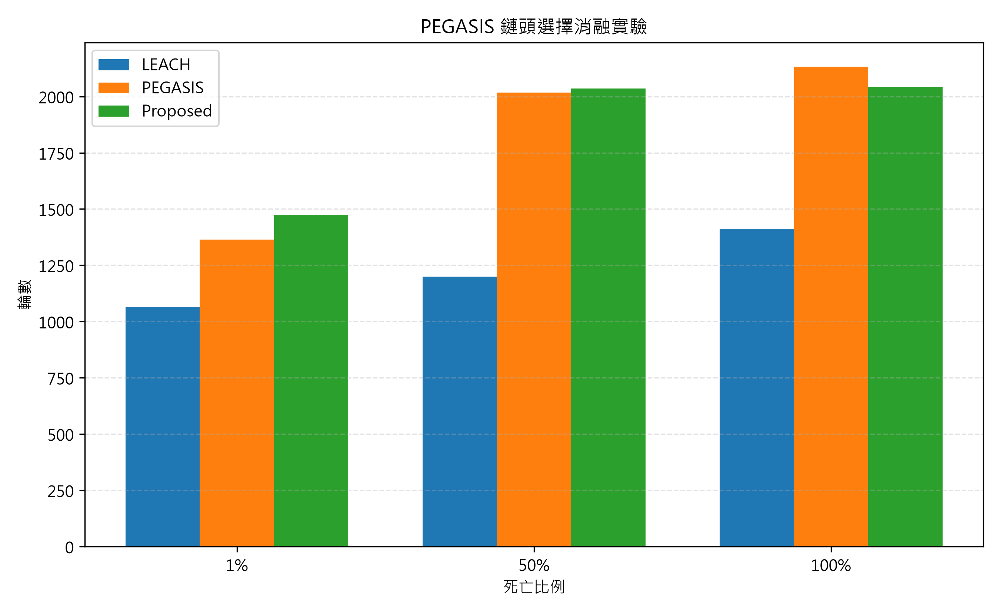

# PEGASIS 鏈頭選擇消融實驗結果

本實驗比較 LEACH、Baseline PEGASIS 與 Proposed PEGASIS。Proposed PEGASIS 將鏈頭選擇由固定輪換改為每輪選擇「剩餘能量 / 到基地台距離」最大的存活節點，其餘 PEGASIS 傳輸與鏈重建邏輯保持相同。

## 結果矩陣

| 協議 | 1% | 50% | 100% | 能量標準差 |
|---|---:|---:|---:|---:|
| LEACH | 1064 | 1199 | 1412 | 0.001532 |
| PEGASIS | 1364 | 2018 | 2133 | 0.000949 |
| Proposed | 1475 | 2035 | 2042 | 0.000750 |

能量標準差為模擬結束時所有節點能量消耗量的標準差；由於每輪扣能為離散事件，節點死亡當輪可能出現小幅負值。

## 圖表

