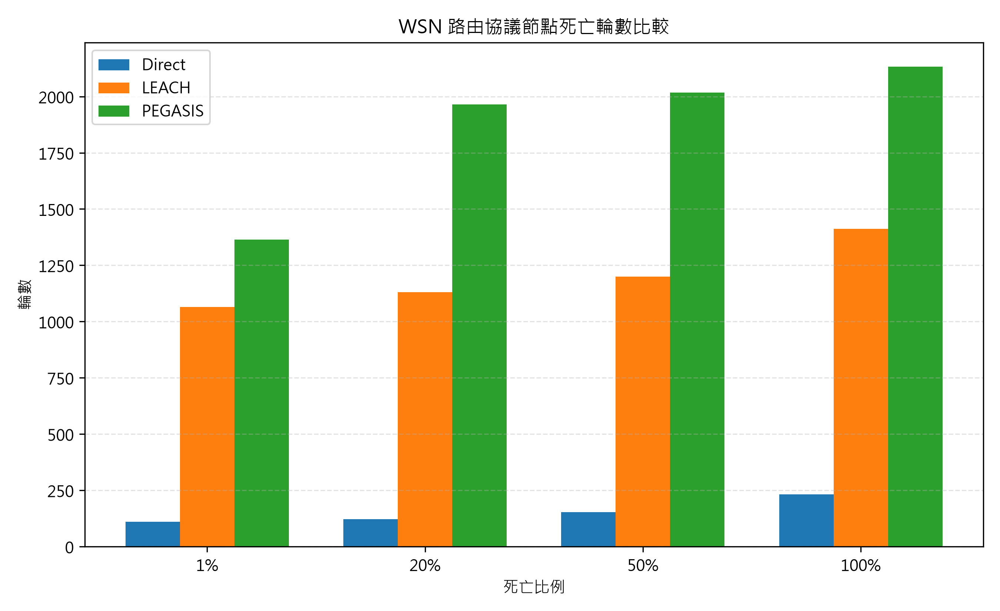

# 無線感測網路節能路由協議之複現研究：Direct Transmission、LEACH 與 PEGASIS 比較

## 1. Abstract

無線感測網路的節點通常受限於電池容量，因此路由協議的能量效率直接影響網路壽命。本研究根據 LEACH 與 PEGASIS 兩篇經典研究，以及一組 100 節點、50m × 50m 場域的複現實驗筆記，整理 Direct Transmission、LEACH 與 PEGASIS 三種資料收集方法的設計差異與模擬結果。方法上，本研究採用一階無線電模型，設定電子電路能耗為 50 nJ/bit、放大器能耗為 100 pJ/bit/m²、資料融合能耗為 5 nJ/bit/message，並以 2000 bits 封包、0.5 J 初始能量與基地台位置 (25, 150) 進行比較。結果顯示，Direct Transmission 在第 110 輪即達到 1% 節點死亡，LEACH 延後至第 1064 輪，PEGASIS 則為第 1364 輪；在 100% 節點死亡時，三者分別為 231、1412 與 2133 輪。整體趨勢支持 PEGASIS > LEACH > Direct 的網路壽命排序，並與 PEGASIS 論文所主張之鏈式路由節能優勢一致。

## 2. Introduction

無線感測網路（Wireless Sensor Networks, WSN）由大量低功耗感測節點組成，常用於環境監測、軍事偵測、工業監控與災害感知等場景。這類網路的核心限制在於節點通常依賴電池供電，且部署後不易維護或更換電池。因此，相較於傳統網路以吞吐量或延遲為主要目標，WSN 的路由協議必須將能量消耗納入核心設計。若節點以不均衡方式消耗能量，部分節點會過早死亡，造成感測覆蓋破洞、網路分割或資料收集失敗。

最直觀的資料收集方式是 Direct Transmission。每個節點在每一輪直接將資料傳送到基地台。此方法具有實作簡單、控制開銷低的優點，但當基地台距離感測場域較遠時，長距離傳輸會造成能量快速消耗。研究脈絡筆記指出，直接傳輸的主要問題正是距離遠、能量消耗大，導致節點快速死亡。這使得後續研究開始尋找能降低遠距離傳輸次數、分散高能耗工作的路由策略。

LEACH（Low-Energy Adaptive Clustering Hierarchy）是 WSN 分簇路由的經典代表。Heinzelman 等人在 2000 年提出 LEACH，透過隨機選舉簇頭、讓一般節點只需短距離傳送至簇頭，再由簇頭進行資料融合並送往基地台，降低整體能耗 [1]。LEACH 的重要性不僅在於分簇，也在於將資料融合納入路由協議設計，使感測資料在傳往基地台前先被壓縮或彙整。根據筆記，LEACH 相較直接傳輸與 MTE 路由，能量消耗最多可降低 8 倍，且最優簇頭比例約為 5%。

PEGASIS（Power-Efficient GAthering in Sensor Information Systems）則是 Lindsey 與 Raghavendra 於 2002 年提出的鏈式路由協議 [2]。其設計方向與 LEACH 不同：不再將節點分成多個簇，而是以貪心演算法建立一條鏈，使每個節點只與鏈上鄰近節點通訊，再由輪值鏈頭將融合後的資料送往基地台。筆記指出，PEGASIS 相較 LEACH 可提升網路壽命 100% 至 300%，在 50m × 50m 網路約為 LEACH 的 2 倍，在 100m × 100m 網路約為 LEACH 的 3 倍。

本研究的問題意識是：在相同一階無線電模型與相同節點部署條件下，Direct Transmission、LEACH 與 PEGASIS 的節點死亡輪數是否能重現經典論文的相對趨勢？本文的貢獻有三點。第一，整理三種協議由直接傳輸、分簇路由到鏈式路由的設計演進。第二，根據筆記中記錄的模擬參數，建立三種協議的一致比較框架。第三，使用複現實驗結果討論 LEACH 與 PEGASIS 的差異、誤差來源與後續研究空缺。

## 3. Related Work

### 3.1 Direct Transmission

Direct Transmission 是最基本的資料收集方式。其假設每個感測節點皆可直接與基地台通訊，每一輪將自身資料封包送至基地台。此方法的優點在於協議幾乎不需要組織程序，也不需要簇頭選舉、鏈建立或排程控制。因此，它常被作為 WSN 節能路由研究中的基準方法。

然而，Direct Transmission 的能量成本高度依賴傳輸距離。在一階無線電模型中，傳輸能耗包含電子電路能耗與距離平方項的放大器能耗。當基地台遠離感測區域時，節點必須付出高昂的遠距離傳輸成本。研究脈絡筆記將此階段概括為「簡單但耗能」，並指出其缺點是距離遠、能量消耗大、節點快速死亡。此問題直接促成了分簇式與鏈式路由的發展。

### 3.2 LEACH

LEACH 代表 WSN 節能路由的第二階段，即分簇路由。其核心概念是將節點自組織為多個簇，每個簇選出一個簇頭。非簇頭節點只需將資料傳送給最近或訊號最強的簇頭，簇頭再接收、融合簇內資料，最後將彙整後的資料傳送至基地台 [1]。這種設計將大量節點的長距離傳輸轉換為局部短距離傳輸，並透過資料融合減少傳往基地台的資料量。

LEACH 的另一個關鍵是簇頭輪換。若固定少數節點長期擔任簇頭，這些節點會因為接收、融合與遠距離傳輸而快速死亡。LEACH 透過隨機輪換簇頭，使能量負載在節點之間平均分散。筆記中記載，LEACH 節點以機率 P 自主選舉為簇頭，建議值為 5%，並使用閾值公式 T(n) = P / (1 - P*(r mod 1/P)) 控制輪換。LEACH 也使用 TDMA 排程，使非傳輸時槽的節點能關閉無線電，並以不同 CDMA 碼降低簇間干擾。

根據 Heinzelman 等人的研究筆記，LEACH 首次將資料融合與路由協定結合，並使第一個節點死亡時間相較其他協定晚約 8 倍，最後一個節點死亡時間晚約 3 倍 [1]。不過，LEACH 仍有侷限，包括假設基地台固定且遠離、節點初始能量相同、未計入簇建立開銷、未考慮節點移動，以及簇頭可能成為瓶頸。這些限制也為後續 PEGASIS 的提出提供了研究動機。

### 3.3 PEGASIS

PEGASIS 屬於鏈式路由。它不採用多簇結構，而是讓所有節點形成一條鏈。鏈的建立方式依筆記記錄為貪心演算法：從離基地台最遠的節點開始，每一步選擇距離目前節點最近的尚未加入節點，直到所有節點都在鏈上。資料收集時，每個節點只與鏈上相鄰節點通訊，資料沿鏈逐步融合，最後由鏈頭將融合後的封包送至基地台 [2]。

PEGASIS 的節能來源有三項。第一，本地傳輸距離短，因為大多數傳輸只發生在相鄰節點之間。第二，鏈頭每輪只需處理少量鄰近訊息，筆記中概括為鏈頭只收 2 個訊息。第三，每一輪僅有 1 次基地台傳輸。相較於 LEACH 多個簇頭分別傳送至基地台，PEGASIS 大幅減少遠距離傳輸次數。Lindsey 與 Raghavendra 的筆記指出，PEGASIS 相較 LEACH 能將網路壽命提升 100% 至 300%，且在 50m × 50m 網路約為 LEACH 的 2 倍 [2]。

但 PEGASIS 也非沒有代價。筆記列出的限制包含假設全局知識、分散式實作困難、貪心鏈不是最優鏈、長鏈會造成延遲、單一鏈頭可能形成瓶頸，以及未討論能量異構。換言之，PEGASIS 強化了能量效率，卻也把問題轉向鏈建立、控制資訊、延遲與可擴展性。

## 4. Methodology

### 4.1 一階無線電模型

本研究依據筆記採用一階無線電模型。傳輸一個 k-bit 封包到距離 d 的能量為：

```text
E_TX(k, d) = E_ELEC * k + EPS_AMP * k * d^2
```

接收一個 k-bit 封包的能量為：

```text
E_RX(k) = E_ELEC * k
```

資料融合能量為：

```text
E_FUSION * k
```

此模型將傳輸能耗拆成固定的電子電路成本與距離平方相關的放大器成本。由於放大器項與 d² 成正比，降低長距離傳輸次數是 LEACH 與 PEGASIS 能提升網路壽命的主要原因。

### 4.2 Direct Transmission 模擬方法

Direct Transmission 的模擬最直接。每一輪中，所有仍存活節點各自產生一個 2000 bits 封包，並直接傳送到基地台。節點每輪扣除一次 E_TX(k, d)，其中 d 為該節點到基地台的距離。由於此方法沒有接收、融合、簇頭選舉或鏈重建，所以結果主要由節點位置與基地台距離決定。

### 4.3 LEACH 模擬方法

LEACH 模擬依筆記採用 5% 節點作為簇頭。每輪先從存活節點中選出約 5% 的節點擔任簇頭，並透過輪換機制避免同一節點長期擔任簇頭。非簇頭節點選擇最近的簇頭加入，並向該簇頭傳送一個封包。簇頭接收簇內節點資料，進行資料融合後，再將融合後資料傳送給基地台。

此模擬保留 LEACH 的核心概念：短距離傳輸、資料融合、簇頭輪換。不過，根據複現實驗筆記，LEACH 的誤差可能與實作簡化有關，例如簇頭選舉、TDMA 排程與 CDMA 干擾未完全重現原論文細節。因此，本文將 LEACH 結果視為核心機制層級的複現，而非完整通訊協定層級的逐項重建。

### 4.4 PEGASIS 模擬方法

PEGASIS 模擬以貪心演算法構鏈。鏈從離基地台最遠的節點開始，反覆選擇最近的尚未加入節點。每輪鏈頭由 rounds % N 決定，使節點輪流承擔傳往基地台的高能耗工作。資料傳輸時，每個節點只與鏈上相鄰節點通訊，資料沿鏈逐步融合，最後由鏈頭將融合資料傳給基地台。當節點死亡後，鏈會根據剩餘存活節點重建。

此設計對應 PEGASIS 的核心思想：避免大量節點直接或透過多個簇頭遠距離傳輸到基地台，而是將大部分能耗限制在近距離鄰居通訊上。由於每輪只有鏈頭進行基地台傳輸，PEGASIS 預期能在同等初始能量下延長節點死亡時間。

## 5. Experiments

### 5.1 參數設定

本研究採用複現實驗筆記中的參數。所有協議使用相同節點數、場域大小、基地台位置、封包大小與初始能量，以確保比較基準一致。

| 參數 | 值 |
|---|---|
| E_ELEC | 50 nJ/bit |
| EPS_AMP | 100 pJ/bit/m² |
| E_FUSION | 5 nJ/bit/message |
| PACKET_SIZE | 2000 bits |
| INIT_ENERGY | 0.5 J |
| NUM_NODES | 100 |
| FIELD_SIZE | 50m × 50m |
| BS_POS | (25, 150) |

評估指標為 1%、20%、50% 與 100% 節點死亡時的輪數。此指標能反映網路壽命的不同階段：1% 死亡代表第一批節點失效，20% 與 50% 死亡代表網路功能逐步衰退，100% 死亡則代表所有節點能量耗盡。

### 5.2 模擬結果

複現實驗得到的節點死亡輪數如下。

| 協議 | 1% | 20% | 50% | 100% |
|---|---:|---:|---:|---:|
| Direct | 110 | 122 | 152 | 231 |
| LEACH | 1064 | 1130 | 1199 | 1412 |
| PEGASIS | 1364 | 1965 | 2018 | 2133 |



結果顯示，Direct Transmission 的節點死亡速度最快，在第 110 輪已有 1% 節點死亡，第 231 輪所有節點死亡。LEACH 顯著延後節點死亡時間，1% 節點死亡出現在第 1064 輪，100% 死亡出現在第 1412 輪。PEGASIS 的表現最佳，1% 節點死亡為第 1364 輪，100% 死亡為第 2133 輪。

若以 100% 節點死亡作為整體網路壽命，LEACH 約為 Direct 的 6.11 倍，PEGASIS 約為 Direct 的 9.23 倍，PEGASIS 約為 LEACH 的 1.51 倍。這些倍率可由本次複現表格直接計算而來，反映鏈式路由相較分簇路由仍有進一步延壽效果。

### 5.3 與論文 Table 1 的比較

複現筆記另記錄了與 PEGASIS 論文 Table 1 的 1% 節點死亡輪數對照，如下表。

| 協議 | 論文 1% | 模擬 1% | 誤差 |
|---|---:|---:|---:|
| Direct | 108 | 110 | +2% |
| LEACH | 803 | 1064 | +32% |
| PEGASIS | 1578 | 1364 | -13% |

正誤差表示模擬結果高於論文值，負誤差表示模擬結果低於論文值。此比較顯示，Direct Transmission 幾乎完全複現，論文為 108 輪，模擬為 110 輪，誤差為 +2%。PEGASIS 在 1% 節點死亡欄位為 -13%，模擬結果低於論文值。LEACH 則偏高，論文為 803 輪，模擬為 1064 輪，誤差為 +32%。儘管數值不完全一致，複現筆記的結論指出核心排序仍成立，即 PEGASIS > LEACH > Direct。

## 6. Discussion

### 6.1 LEACH 誤差分析

LEACH 在本次複現中出現較明顯的正向誤差。簡化模擬可能高估了 LEACH 的節能效果，因為省略了簇頭選舉、TDMA 排程、CDMA 干擾等額外開銷。

另一個可能原因是 LEACH 原始方法中的簇頭選舉具有更具體的機率閾值與輪次集合控制。筆記中記錄的 T(n) = P / (1 - P*(r mod 1/P)) 用於避免近期已擔任簇頭的節點再次被選中。若複現模擬使用較簡化的輪替方式，可能使簇頭分布更均衡或更理想，進而延長節點壽命。因此，本研究不將 LEACH 偏高解讀為原論文錯誤，而是將其視為協議細節對結果敏感的證據。

### 6.2 PEGASIS 優勢

PEGASIS 的優勢來自於對遠距離傳輸的極端壓縮。LEACH 雖已將一般節點的遠距離傳輸改為到簇頭的短距離傳輸，但每一輪仍有多個簇頭需要向基地台傳輸。PEGASIS 則讓每輪只有一個鏈頭向基地台傳輸，其他節點多數只與相鄰節點通訊。由於能量模型中放大器能耗與距離平方成正比，減少基地台傳輸次數會帶來顯著效益。

複現結果也支持此點。PEGASIS 在 20%、50% 與 100% 節點死亡時均明顯高於 LEACH，尤其 20% 死亡時為 1965 輪，而 LEACH 為 1130 輪。這表示 PEGASIS 不只是延後第一個節點死亡，也能在網路中期維持更長的存活時間。此結果符合 PEGASIS 筆記所述，在 50m × 50m 網路下約可達 LEACH 的 2 倍壽命趨勢，雖然本次 100% 死亡輪數的比例約為 1.51 倍。

然而，PEGASIS 的優勢伴隨實作成本。其需要全局拓撲知識來建立鏈，貪心鏈也不保證全域最短。長鏈可能導致資料收集延遲，單一鏈頭也可能形成瓶頸。此外，當節點死亡後重建鏈會帶來控制負擔。這些問題在簡化模擬中不一定完全反映，但在實際部署中會影響可行性。

### 6.3 研究空缺

四份筆記共同指出數個研究空缺。第一是分散式構鏈方法。PEGASIS 的全局知識假設使其難以直接用於大規模或動態 WSN，因此如何在局部資訊下建立近似高效的鏈，是重要方向。第二是能量異構節點的處理。LEACH 與 PEGASIS 筆記皆提到原始假設多以同質能量節點為主，但實際網路可能包含不同電池容量或不同任務負載的節點。

第三是移動性支援。LEACH 筆記指出原協議未考慮節點移動，PEGASIS 的鏈結構在拓撲變化下也可能需要頻繁重建。第四是多鏈與分簇混合架構。LEACH 的分簇能降低延遲並提升局部管理性，PEGASIS 的鏈式傳輸能減少基地台傳輸次數。若能結合兩者，可能在能耗、延遲與擴展性之間取得更好的平衡。

## 7. Conclusion

本文根據四份 Obsidian 筆記整理 Direct Transmission、LEACH 與 PEGASIS 的研究脈絡、方法設計與複現實驗結果。Direct Transmission 作為基準方法，實作簡單但因遠距離傳輸而快速耗能。LEACH 透過分簇、資料融合與簇頭輪換，大幅延長節點壽命。PEGASIS 則進一步以鏈式結構降低遠距離傳輸次數，使每輪僅由一個鏈頭向基地台傳送融合資料。

複現實驗在 100 節點、50m × 50m 場域、0.5 J 初始能量與基地台位置 (25, 150) 下得到清楚趨勢：Direct、LEACH 與 PEGASIS 的 100% 節點死亡輪數分別為 231、1412 與 2133 輪。與論文 Table 1 的 1% 死亡輪數比較中，Direct 幾乎完全複現，PEGASIS 存在 -13% 誤差，LEACH 則偏高 +32%。儘管具體數值存在差異，核心結論仍成功複現：PEGASIS 的網路壽命優於 LEACH，而 LEACH 又明顯優於 Direct Transmission。

未來研究可從三個方向延伸。首先，可更完整重現 LEACH 的簇頭閾值公式、TDMA 排程與 CDMA 干擾，以釐清誤差來源。其次，可改進 PEGASIS 的構鏈策略，探索分散式、多鏈或混合分簇鏈式架構。最後，可將能量異構與節點移動納入模型，使模擬更接近實際 WSN 部署情境。本研究目前僅涵蓋兩篇核心文獻，未來可擴充至更多 WSN 節能路由相關研究，以建立更完整的文獻脈絡。

## 8. References

[1] W. R. Heinzelman, A. Chandrakasan, and H. Balakrishnan, "Energy-Efficient Communication Protocol for Wireless Microsensor Networks," Hawaii International Conference on System Sciences, 2000.

[2] S. Lindsey and C. S. Raghavendra, "PEGASIS: Power-Efficient GAthering in Sensor Information Systems," IEEE Aerospace Conference, 2002.
